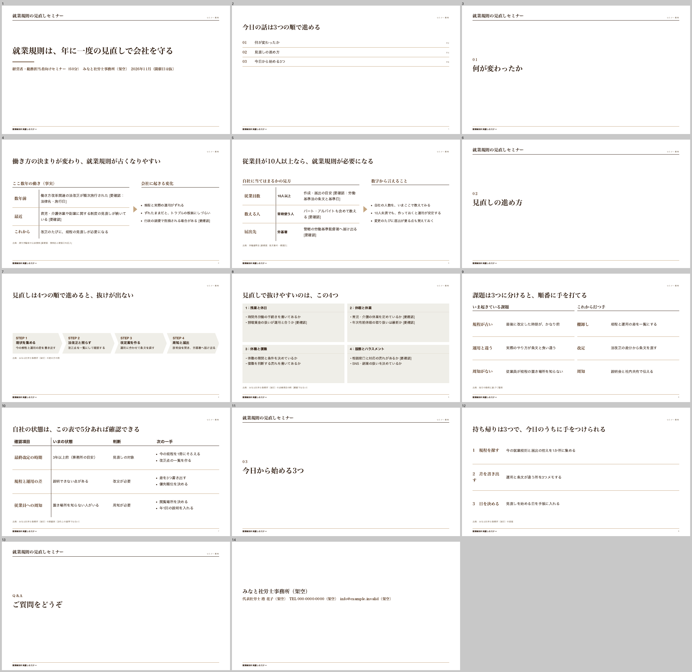

# shiryo-kit — 聴き切ってから作る、出典を確かめた資料づくり

セミナー資料・顧問先への説明資料・提案資料・報告資料を、AI と一緒に作るための道具です。一人で事務所を回している社労士などの士業の方や、中小企業の担当の方に向けて作りました。
作り始める前に AI が必要なことを聴き取り、法令や金額は公的な原典 (役所や e-Gov 法令検索などの元の資料) で確かめ、確かめられない所は **[要確認]** と書いて残します。できあがるのは、文字や表をそのまま直せる PowerPoint・PDF・読み原稿です。あわせて、どの主張をどの原典で確かめたかの一覧 (出典の一覧) を作ります。

## おすすめの使い方 — Claude か ChatGPT のアプリに「スキル」として入れる

Claude の **「Cowork」** か、ChatGPT の **「Work」** で使います。どちらも、ふだんのチャットとは別の「AI に作業を任せる」切り替え先で、AI が手順に沿って作業を進め、ファイルまで作ってくれます。そこに shiryo-kit を **「スキル」** (AI に渡す手順書のフォルダ) として 1 回入れます。ターミナル (黒い画面) は要りません。

> **2026 年 10 月 19 日に、ブラウザ版 (claude.ai と chatgpt.com) で最初から最後まで通しました。** どちらも shiryo-kit が読み込まれ、聴き取り → 要約の承認 → 直せる PowerPoint (17 枚)・PDF・読み原稿までできました (架空の依頼で、作った側が試したものです)。画面の名前は、試した時のブラウザ版のものです。
> **デスクトップアプリも試しました。** Claude のデスクトップアプリは、ブラウザ版で入れたスキルがそのまま出て、要約の承認まで同じ手順で進みました (書き出しの結果までは確かめていません)。**ChatGPT のデスクトップアプリには、スキルの ZIP を入れる入口がありません。ChatGPT はブラウザ版 (chatgpt.com) で入れて、ブラウザ版で使ってください。**

**要るもの**

ふだんお使いの方のアプリを選んでください。どちらも使っているなら、Claude をおすすめします (下の「品質について」)。

- **Claude なら、有料プラン** (Pro・Max・Team・Enterprise)。Cowork は有料プランだけの機能です。
- **ChatGPT なら、ChatGPT のアカウント。** 試した時は、ブラウザ版でスキルを入れて使えました (試したアカウントのプランは確かめていません)。無料・Go のプランで自分のスキルを入れられるかは確かめていません。続けて使うなら Plus 以上と考えてください。
- スキルの ZIP ファイル `shiryo-kit-skill.zip` (手順 1)。公開の時に置きます。まだ置かれていない間は、この方法は使えません。下の「ほかの使い方」をお使いください。
- 金額は各社がよく変えるので、ここには書きません。プランの条件は 2026 年 10 月 19 日時点の公式のヘルプの内容です。変わっていたら、各社の最新の案内を優先してください。

**手順** (画面の名前は「日本語の画面 (英語の画面)」の形で書きます。片方しか確かめていない所は、確かめた方だけ書きます)

1. **スキルの ZIP を取る。** このページの右側 (スマホでは下の方) にある **「Releases」** (配布物の置き場) を押し、いちばん新しい版の「Assets」の中にある **`shiryo-kit-skill.zip`** を押してダウンロードします。同じ所に並ぶ「Source code」の ZIP は押しません。
   - **ZIP は開かず (展開せず)、そのまま使います。** Mac の Safari は ZIP を自動で開いてしまうことがあります。`shiryo-kit` というフォルダになっていたら、そのフォルダを右クリック →「"shiryo-kit" を圧縮」で ZIP に戻してください。入るスキルの名前は、ZIP の中の手順書から付きます (試した時は ZIP の名前ではなく、Claude では「shiryo-kit」、ChatGPT では「shiryo-kit 資料づくり」と出ました。圧縮し直した ZIP では試していません)。
2. **アプリに入れて、頼む。** 使い方の動画: Claude は [docs/videos/shiryo-kit-claude.mp4](docs/videos/shiryo-kit-claude.mp4)、ChatGPT は [docs/videos/shiryo-kit-chatgpt.mp4](docs/videos/shiryo-kit-chatgpt.mp4) (どちらも 2 分以内)。
   - **Claude** (試した画面は英語。日本語の名前は、無料のアカウントの日本語の画面で確かめたもの)
     1. 「カスタマイズ」(Customize) →「Skills」のタブ →「追加」(Add) →「Skills をアップロード」(Upload skill) を押し、ZIP を選んで「Upload」を押します。一覧に出た `shiryo-kit` が ON になっていれば入っています。
        - 「設定」→「機能」に「コードの実行とファイルの作成」がある時は ON にします。無ければ飛ばして大丈夫です (会社のプランでは、この切り替えがありませんでした)。
        - 会社のプラン (Team・Enterprise) で「Skills」の欄が無い時は、管理者に確かめてください。
        - ブラウザ版で入れたスキルは、Claude のデスクトップアプリにも自動で出ます。新しい版は、同じ手順で入れ直すと「Replace "shiryo-kit"?」と聞かれるので「Upload and replace」を押せば置き換わります。
     2. メッセージ欄の「チャット | Cowork」(Chat | Cowork) で **Cowork** を選びます。モデルの選ぶ所で名前に **「Opus」** と付くものを選び、「Effort」を **「High」** にします。
     3. 「セミナー資料を作りたい」のように、ふつうの言葉で頼みます。**右の欄の「Context」→「Skills」に shiryo-kit と出て、「Progress」に作業の段階が並べば、shiryo-kit が動いています。**
     4. ブラウザ版では、メッセージ欄のすぐ下の左が **「Manual」** のままだと、AI がコマンドを動かすたびに「Allow once」(許可) を押すまで止まることがあります (デスクトップアプリで試した時は、見ていた範囲では止まらず、役所のページを開く時に 1 回聞かれました)。止めずに進めたい時は、「Manual」を押して **「Automatically approve」** に変えます (この間は、つないであるコネクタ (Gmail・Google Drive など) も確認なしで使います。顧問先の情報につながるコネクタがある時は、「Manual」のまま許可を押してください)。役所のページを読む時に聞かれたら「Allow all for this website」(デスクトップアプリでは「Always allow for this website」) を押します。
     5. 質問は選択式のカードで出ます。最後に要約が出て「この内容で作り始めてよいですか」と聞かれるので、カードか、文字で「この内容で」と返します。
   - **ChatGPT** (試した画面は日本語。**ブラウザ版 chatgpt.com で行います**。デスクトップアプリには ZIP を入れる入口がありません)
     1. 左端のアイコンの列から「カスタマイズ」を開き (アイコンだけで、文字は出ていません)、「スキル」→「追加」→「コンピューターからアップロード」を押し、ZIP を選びます (.zip、25 MB まで)。「スキルをアップロードしました」と出たら「完了」を押します。一覧に「shiryo-kit 資料づくり」と出ます。**「プラグイン」の画面の「プラグインアーカイブをアップロード」は使いません。**
     2. 上の「Chat | Work」で **Work** に切り替えます。モデルの選ぶ所の「モデルを選択」で **「GPT-6 Astra」** を選び、思考量のつまみを **「高」** に合わせます。
     3. 「@shiryo」と打つと「shiryo-kit 資料づくり」が出るので選び、続けて「セミナー資料を作りたい」のように頼みます。最初の返事に「shiryo-kit を使って」と出れば動いています。
     4. 質問のカードに答えると、要約が出ます。よければ、文字で「この内容で」と返します (直したい所があれば、直す所だけを書きます。直した要約がもう一度出るので、それに「この内容で」と返します)。
   - どちらも、過去の資料があれば頼む時に添付してください。うまく入らない・動かない時は、無理に続けず、下の「ほかの使い方」をお使いください。
3. **受け取る。**
   - **Claude**: 右の欄の「Outputs」か、最後のメッセージの下のファイルのカードから取ります。カードの「Google Drive」の右の **「⌄」→「Download」** を押します (「Google Drive」そのものを押すと Google Drive の接続を求められますが、要りません)。
   - **ChatGPT**: 右の欄の「出力」か、メッセージの下のファイルの一覧から、ファイルを開いて右上の **「⬇」→「元のファイル」** を押します。
   - 最後に AI が、点検の状態 (「検品済み」か「未検品」か) と、[要確認] の一覧 (何を・どこで確かめればよいか) を報告します。

**Cowork・Work の中で起こりうること**

- **PowerPoint は、多くの場合ふつうに Chrome で書き出します** (ブラウザ版で試した時は Cowork・Work とも Chrome が使えました。ChatGPT のデスクトップアプリで、承認の設定を「Approve for me」にして試した時は使えませんでした)。Chrome が使えない時は、shiryo-kit が自分で持っている「予備の書き出し」で作ります。文字も表もそのまま直せる PowerPoint ですが、最後の報告に **「描画の確認ができていない書き出しです」** と出ます。はみ出し・重なりを機械で確かめられていない、という意味です。PowerPoint で開いて、目で確かめてください。その時は PDF を作れないこともあります (PowerPoint から PDF に保存してください)。
- **作った AI とは別の AI による点検:** Cowork では、試した時にできました。**ChatGPT の Work では、別の AI の点検ができず、「未検品」になりました** (ブラウザ版では点検用の AI から応答が無く、原因は分かっていません。デスクトップアプリでは、実行の制限で点検用の AI を起動できませんでした)。その時、AI が「手で頼む点検」の 3 つのファイル (依頼文・PDF・出典の一覧) を渡します。新しいチャット (できれば別の AI。その AI の会社にも資料が送られるので、顧問先の名前などが入っていないか確かめてから) に PDF と出典の一覧を添付し、依頼文の中身を貼って送ると点検してもらえます。返ってきた指摘を元の作業に貼ると直します (状態は「未検品」のままです)。
- 次回のためのメモ (聞いた内容の保存) が、次の作業に引き継がれるかはまだ試していません。

**顧問先の従業員の名前・連絡先・健康のことなどは、貼らない・読ませないでください。** 会話と読ませたファイルの中身は、AI の会社 (Claude は Anthropic、ChatGPT は OpenAI) のサーバーに送られて処理されます。詳しくは下の「[顧問先の情報と、AI の会社に送られるもの](#顧問先の情報とai-の会社に送られるもの)」にあります。

## ほかの使い方

上のおすすめが使えない時は、Claude Code か Codex (AI にパソコンの中の作業を任せるアプリ) を使えるかどうかで選んでください。使えるなら 2 番目、使えないなら 3 番目です。Claude Code はデスクトップアプリで使えるので、ターミナル (黒い画面) を使ったことが無くても 2 番目を選べます。

- **2 番目: Claude Code か Codex を使う方 (デスクトップアプリでも、ターミナルでも)** → **[docs/agent-setup.md](docs/agent-setup.md)**。中身はおすすめの方法と同じスキルで、Chrome でスライドを描いて確かめるところまで動きます (作った側の Mac で確かめた段階です)。Claude の有料プランか、ChatGPT の有料プランが要ります。
- **3 番目 (予備): チャット版** → **[chat/README.md](chat/README.md)**。ふだんの ChatGPT・Claude・Gemini の「プロジェクト」(Gemini は「Gem」) に、指示文を 1 つ貼るだけで使えます。無料プランでも試せます。ただし品質が落ちます。
  - **編集できる PowerPoint のファイルを、チャット版は自分では作りません。** 見た目のスライドは、各社のスライド機能に文面を渡して作ります (文字が直せる形になるかは、まだ確かめていません)。
  - **チャット版は「別の AI による点検」ができません。** 同じ会話の中で見直すだけなので、最後は必ず「未検品」と表示します。
  - ほかの違い (過去資料は手で添付する、など) は [chat/README.md](chat/README.md) の §2 にあります。

> **まだ「未検証」です。** これまでの動作の確認は、作った側が架空のデータで行っただけです (おすすめの使い方はブラウザ版で 1 回ずつ。2 番目の方法は作った側の Mac で)。実際の利用者の環境 (デスクトップアプリ・Windows を含む) で、最初から最後まで通す試験はまだしていません。終わった環境から「未検証」を外します。

**品質について。** 正直に書くと、Codex (gpt-6-astra) は Claude Code (Opus 5.5) より品質が少し落ちます (作った側の評価です)。ChatGPT の Work でも同じ傾向と考えてください (Work では 1 回通しただけで、品質の比べ方はしていません)。全部の工程は Codex でも動くように作ってあります。

---

## 何が違うのか

スキルとして入れた時 (おすすめの方法と 2 番目の方法) は、設計としてこう作ってあります (実際の利用者の環境ではまだ確かめていません)。チャット版で弱くなる所は、上の「ほかの使い方」に書いた通りです。

- **作る前に、一度にまとめて聞きます。** 目的・聞く人・時間・何日時点の制度で書くか・入れない話題・口調・欲しい物など。おすすめの答えが付いているので「はい」か番号で答えられます。最後に要約を見せ、あなたが「この内容で」と言うまで作りません。
- **原典の本文をそのまま引用できたものだけを「確認済み」と呼びます。** 原典のページを実際に取得して保存し、引用した文が本当にそこにあるかをプログラムで確かめます。取れなかった・合わなかった・まだ施行されていない・対象が違う所は、資料の中に **[要確認]** と出し、数字を作りません。
- **あなたの過去の資料から、口調と構成の癖を抜き出します。** どのファイルのどの言い回しかを見せて確かめてから、文面と読み原稿に反映します。
- **作った AI とは別の AI が点検します。** 要件どおりか・原典と合っているか・言い過ぎていないかを見ます。点検できなかった時は「未検品」と表示し、完了とは言いません。点検した版と、お渡しする版が同じかも確かめます。
- **聞いたことをメモに残し、次回はおすすめの答えとして出します。** 残す前に必ず見せます。別の顧問先の話は持ち込みません。

それでも AI は間違えることがあります。人前に出す前に、[要確認] の所と、出典一覧の URL は必ずご自分で開いて確かめてください。この道具は法律の助言をするものではありません。

## 出来上がりの見本

型「セミナー」の見本です (架空の事務所。全 14 枚の縮小)。原典で確かめていない所に [要確認] が付いています。



ほかの型: [顧問先説明](skill/shiryo-kit/assets/kata/advisory/preview.png) / [提案](skill/shiryo-kit/assets/kata/proposal/preview.png) / [報告](skill/shiryo-kit/assets/kata/report/preview.png)

出典の一覧 (出典台帳) は、たとえば次のような形になります (抜粋。1 行目の引用は 2026-10-18 に厚生労働省のページから取得した文、2・3 行目は試験用の架空の主張です)。

| 主張 | 区分 | 出典 | 引用 (原典の文そのまま) | いつから・対象 |
|---|---|---|---|---|
| 賃金の要件 (月 8.8 万円以上) は 2026 年 10 月に撤廃された | 確認済み | https://www.mhlw.go.jp/tekiyoukakudai/qa/ (2026-10-18 取得) | 「賃金要件（所定内賃金の月額が8.8万円以上）については、令和７年年金制度改正により、2026年10月に撤廃されました。」 | 2026 年 10 月から |
| 従業員 42 人の会社は 11 月から加入の対象になる | 未確認 | (同上) | — | 36〜50 人の会社は 2027 年 10 月からで、11 月の時点では対象外。資料には [要確認] と出し、指摘します |
| セミナーは 2026 年 11 月 20 日 | あなたが言ったこと | — | — | 聴き取りでの答え。原典では照らしていません |

---

## 対応環境

**全部「未検証」です** (実際の利用者の環境で、入口から成果物まで通す試験をまだしていません。Cowork・Work は、作った側がブラウザ版で 1 回ずつ通しただけです)。プランの条件は 2026-10-18 時点で各社の公式ページを調べた内容で、変わることがあります。細かい表と根拠は、チャット版は [chat/README.md](chat/README.md) の §3、Claude Code・Codex は [docs/agent-setup.md](docs/agent-setup.md) の「対応環境」、Cowork・Work も含めた根拠のページは [docs/compat.md](docs/compat.md) にあります。

| 環境 | 必要なプラン | 初期設定 | 使えない・弱い機能 | 検証状況 |
|---|---|---|---|---|
| Claude の「Cowork」(おすすめ) | Pro・Max・Team・Enterprise (有料プランだけ) | `shiryo-kit-skill.zip` を「カスタマイズ」→「Skills」→「追加」→「Skills をアップロード」 | 既定の「Manual」ではコマンドごとに許可待ちで止まる (「Automatically approve」に変えられる)。Chrome が動かない時は予備の書き出し。メモの引き継ぎは未確認 | ブラウザ版で通した (2026-10-19、作った側。Chrome で書き出し・別の AI の点検もできた)。デスクトップアプリは未確認 |
| ChatGPT の「Work」(おすすめ) | 無料を含む全プランに Work は入っている。自分のスキルを入れられるプランは未確認 (Plus 以上と考えてください) | `shiryo-kit-skill.zip` を「カスタマイズ」→「スキル」→「追加」→「コンピューターからアップロード」 | 別の AI による点検が何も返さず「未検品」になった (手で頼む点検を案内する)。メモの引き継ぎは未確認 | ブラウザ版で通した (2026-10-19、作った側。Chrome で書き出し)。デスクトップアプリは未確認 |
| ChatGPT の「プロジェクト」(チャット版) | 無料を含む全プラン | プロジェクトへの指示に `chat/instructions.md` を貼る | 別の AI による点検、編集できる PowerPoint の書き出し、原典を開いたかの機械の確認 | 未検証 |
| Claude の「プロジェクト」(チャット版) | 無料を含む全プラン (無料はプロジェクト 5 つまで) | 同上 | 同上 | 未検証 |
| Gemini の「Gem」(チャット版) | 公式ページに記載なし | 同上 (パソコンのブラウザで作る) | 同上。個人のアカウントでは 2026-11-17 から「スキル」に移る | 未検証 |
| Claude Code | Claude の Pro・Max・Team・Enterprise か API の契約。無料プランでは使えない | `install.sh --claude` / `install.ps1 -Claude` | 画面で指して直す: 未確認。Windows の install.ps1 は一度も動かしていない | 未検証 |
| Codex | ChatGPT の Plus 以上 (無料・Go でおすすめのモデルが使えるかは未確認) | `install.sh --codex` / `install.ps1 -Codex` | 画面で指して直す: 未確認。原典を取りに行く時、ネットへの接続の許可を求められることがある。PowerPoint・PDF の書き出しと別の AI による点検の時に、Codex の安全のための囲いの外で動かしてよいかの許可を求められる (許可しないと、PowerPoint は確認の無い予備の書き出しになり、点検は「未検品」になる) | 未検証 |

ChatGPT の「プロジェクト」の行の条件は、公式ページが開けず、検索結果の要約で確かめたものです。PowerPoint で開いた時の崩れは、まだ実際の PowerPoint (Windows・Mac) で確かめていません。

## 顧問先の情報と、AI の会社に送られるもの

- どの使い方でも、会話と、AI に読ませたファイルの中身は、AI の会社 (ChatGPT は OpenAI、Claude は Anthropic、Gemini は Google) のサーバーに送られて処理されます。
- Claude の Cowork では、作業そのものも Anthropic のサーバーの上の囲われた場所で動き、作業とファイルは Claude のアカウントに保存されます (公式のヘルプの説明)。ChatGPT の Work も、クラウドで動かす時は同じように OpenAI の側で動きます。
- **顧問先の従業員の名前・連絡先・健康のこと・給与などは、貼らない・読ませないでください。** AI は写さない決まりにしてありますが、送らないのがいちばん確かです。過去資料は、先に個人の情報を消すか伏せてから使ってください。
- 会話が AI の学習に使われる設定になっていないか、使う前に各社の設定画面で確かめてください。画面の名前の例 (2026-10 時点。変わることがあります): ChatGPT は「設定」→「データコントロール」、Claude は「設定」→「プライバシー」、Gemini は「アクティビティ」(「アクティビティを保持」)。会社のプラン (Team・Business・Enterprise など) は、契約で扱いが決まっていることが多いので、管理者に確かめてください。
- 守秘義務との関係は、最後はご自身の判断になります。何を読み・何を外に送り・何を保存するかの一覧は、スキルとして入れた時は [docs/agent-setup.md](docs/agent-setup.md) の「何を読み、何を外に送り、何を保存するか」、チャット版は [chat/README.md](chat/README.md) の §2 にあります。

---

## できないこと・限界

- **AI は間違えます。** 「確認済み」は「原典のページに同じ文がある」ことまでで、その読み方が正しいか、あなたの顧問先に当てはまるかまでは保証しません。人前に出す前に、ご自身で確かめてください。法律の助言はしません。
- 原典を取りに行けない環境 (ネットにつながらない、取得が止められている) では、主張は全部 [要確認] になります。
- 図や絵の中の文字は、PowerPoint で直せない絵になります (読ませる文字は図の外の文字として置きます)。
- 見た目は、既にある部品を流用した落ち着いたデザインです。凝ったデザインや、事務所のひな形に合わせることはしません。
- 過去資料が少ない・無い時は、口調の反映が浅くなります (その時は聴き取りで口調を聞きます)。
- 1 つの資料を作るのに、聴き取り・原典の確認・点検で時間がかかります。速さより、間違えないことを優先しています。

---

## 使い方の動画

- Claude (Cowork) で入れて使う: [docs/videos/shiryo-kit-claude.mp4](docs/videos/shiryo-kit-claude.mp4)
- ChatGPT (Work) で入れて使う: [docs/videos/shiryo-kit-chatgpt.mp4](docs/videos/shiryo-kit-chatgpt.mp4)
- Claude Code・Codex (2 番目の方法) で使う: [docs/videos/shiryo-kit-code.mp4](docs/videos/shiryo-kit-code.mp4)

上の 2 本 (Claude・ChatGPT) は、ブラウザ版の画面で撮りました。待ち時間は省いています。

## お問い合わせ

不具合・要望は GitHub の Issues へ。このページの上にある **「Issues」** → **「New issue」** から書いてください (GitHub のアカウントが要ります。無料で作れます)。
Issues は誰でも読めます。**顧問先の名前や個人の情報、資料の中身は書かないでください。**

---

## ことば

| ことば | 意味 |
|---|---|
| Cowork・Work | Claude のアプリの「Cowork」と、ChatGPT のアプリの「Work」。AI が手順に沿って作業を進め、プログラムを動かしてファイルまで作る使い方です |
| エージェント版 | スキルとして入れて使う shiryo-kit (おすすめの方法と 2 番目の方法)。チャット版と区別する時の呼び名です。ほかのページではこう呼んでいます |
| エージェント | パソコンの中のファイルを読んだり、プログラムを動かしたりしながら作業する AI。Claude Code と Codex がそれ |
| スキル | AI に追加で渡す手順書のフォルダ。shiryo-kit はスキルとして入れます。Cowork・Work には、フォルダを ZIP にした `shiryo-kit-skill.zip` を入れます |
| 文字で操作する版 | 黒い画面 (ターミナル) に文字を打って使う版。デスクトップアプリでも同じことができます |
| 原典 | 法令・通達・役所の案内など、元の公的な資料。解説記事や他の事務所のサイトは原典に入れません |
| 検品・点検 | 作った AI とは別の AI が、出来た資料を確かめること。できなかった時は「未検品」と表示します |
| 予備の書き出し | Chrome が動かない所で、shiryo-kit が自分で PowerPoint を組み立てる書き出し方。直せる PowerPoint になりますが、はみ出し・重なりを機械で確かめていないので「描画の確認ができていない書き出しです」と表示します |
| 出典台帳 | 資料の中の「確かめが要る主張」の一覧。どこで確かめたか・確かめられなかったかを 1 行ずつ書きます |
| モデル / effort | AI の種類と、考える深さ。スキルとして入れた時は「Opus」(Claude) か「gpt-6-astra」(ChatGPT・Codex) を、考える深さ「high」で使います |
| プロジェクト | ChatGPT・Claude の機能。指示文を 1 回貼っておくと、その中の会話すべてで使われます。チャット版はこれを使います |
| Gem | Gemini の機能。プロジェクトと同じように、指示文を貼っておけます |

---

## フォルダの中身 (直す人向け)

```
skill/shiryo-kit/   スキルの本体 (Cowork・Work・Claude Code・Codex で同じもの) (SKILL.md、references/ に工程ごとの決まり、scripts/ に書き出しと点検のプログラム、assets/ に部品と型)
chat/               チャット版 (chat/README.md)
docs/               Claude Code・Codex での準備と使い方 (docs/agent-setup.md)、対応環境の根拠 (docs/compat.md)
tools/              配る物を作るプログラム (tools/build_skill_zip.py = Cowork・Work 用の ZIP)
tests/              試験用の架空のデータと、プログラムの試験
install.sh          Mac・Linux 用の入れ方
install.ps1         Windows 用の入れ方
NOTICE              元にしたソフトの著作権表示
LICENSE             この道具のライセンス (MIT)
```

### 公開する人へ: スキルの ZIP を Releases に置く

おすすめの使い方の手順 1 は、`shiryo-kit-skill.zip` が GitHub の Releases に置いてあることが前提です。版を出す時に、次のどちらかを repo の一番上のフォルダで実行し、できた ZIP を Release に添付してください。

```
python3 tools/build_skill_zip.py --check       # 中身を組み立てて確かめるだけ (何も書かない)。問題があれば NG と終了コード 1
python3 tools/build_skill_zip.py --out dist    # dist/shiryo-kit-skill.zip を作る (dist/ は git が無視する場所。repo の外の場所も指定できる)
```

- ZIP の最上位は `shiryo-kit/` フォルダで、その中に `SKILL.md` があります (Claude のヘルプ「カスタムスキルの作成方法」の形)。`__pycache__`・`.DS_Store`・`tests` などは入れません。
- ZIP の中の `SKILL.md` だけ、先頭の項目 (frontmatter) を `name` と、200 字以内の `description` に差し替えます。claude.ai のアップロードは description を 200 字までとしているためです。`skill/shiryo-kit/SKILL.md` (正本) は変えません。
- Release に置く前に、作業中で commit していない変更が無いことを確かめてください (ZIP は今のフォルダの中身から作ります)。

---

## ライセンスと出典

- この道具は **MIT ライセンス** です ([LICENSE](LICENSE))。
- PowerPoint への書き出しの部分は、carnot-tech/consulting-pptx-skill (MIT ライセンス) を元に、日本語の空白の扱い・読み原稿のノート・ブラウザの探し方などを直して同梱しています。型の見本と、作った資料の HTML にも、元の部品の見た目 (CSS) と組み方が入っています。元の著作権表示と、どのファイルを元にしたかは [NOTICE](NOTICE) にあります。shiryo-kit は元のプロジェクトや作者とは関係がなく、公認された版でもありません。元のプロジェクトの名前や商標は、この道具の名前には使っていません。
- 聴き取り・点検などの手順は、mattpocock/skills、obra/superpowers、github/spec-kit、BMAD-METHOD、CyberPPT (いずれも MIT) などを参考に、文言は写さずに書き直しました。資料の判断の軸は Minto・Abela・Duarte ほかによります。どこから来たかは `skill/shiryo-kit/references/` の各ファイルの末尾にあります。
- 見本と試験のデータに出てくる事務所・会社・人物は、すべて架空です (出典台帳の見本の 1 行目の引用だけは、実際の厚生労働省のページの文です)。
